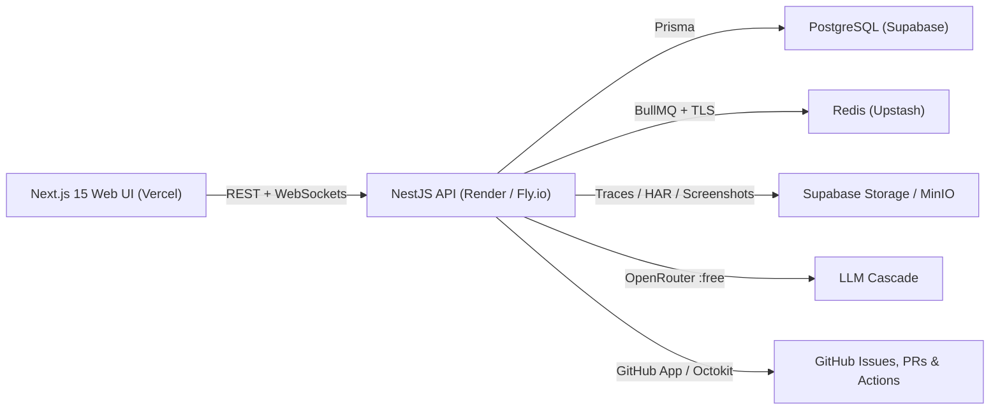

# TestPilot — AI-Native Self-Healing QA Platform

TestPilot is an autonomous Playwright test automation platform that crawls web applications, generates maintainable Page Object Model (POM) test suites, executes tests with full trace/HAR/screenshot capture, self-heals broken locators via GitHub Pull Requests, and manages product defects end-to-end.

## Architecture Overview



## Key Capabilities

- **Autonomous Discovery & Crawling:** Playwright-based BFS crawler with `robots.txt` compliance, SPA route detection, element fingerprinting, and PII-redacted HAR recording.
- **Two-Pass AI Test Generation:** Generates structured QA scenarios for human review, then compiles TypeScript Playwright specs, Page Objects, fixtures, and `playwright.config.ts` directly into your repository via PR.
- **Deterministic-First Self-Healing:** Multi-signal locator scoring (data-testid, ARIA, text, DOM hierarchy, visual geometry) with an LLM tie-breaker and automated healing PRs.
- **Closed-Loop Defect Lifecycle:** Failure classification (`LOCATOR_DRIFT` vs `PRODUCT_BUG`), GitHub Issue creation with evidence, optional Jira bidirectional sync, LLM severity suggestion, and automated re-verification on `ready-for-qa`.
- **Scheduling, Security & Observability:** Cron-based BullMQ schedules, Slack/Email/GitHub notifications, AES-256-GCM secret encryption, immutable audit trail, OpenTelemetry tracing, Prometheus `/api/v1/metrics`, Opossum circuit breakers, and Dead-Letter Queue (DLQ).

## Free-Tier Production Stack

| Layer | Service | Free Tier Allowance |
|---|---|---|
| Frontend (`@testpilot/web`) | **Vercel** | Unlimited Hobby deployments, automatic HTTPS/SSL & custom domain |
| Backend API (`@testpilot/api`) | **Render** (`render.yaml`) or **Fly.io** (`fly.api.toml`) | Free Docker web service / shared-cpu-1x VM with automatic HTTPS/SSL |
| Database & Artifacts | **Supabase** | 500 MB PostgreSQL + 1 GB S3-compatible artifact storage |
| Queue & Cache | **Upstash** | 10,000 commands/day serverless Redis over `rediss://` TLS |
| Auth | **Clerk** | Up to 10,000 MAUs |
| LLM Inference | **OpenRouter** | `:free` model cascade with multi-key rotation |
| Container Registry | **GitHub Container Registry (`ghcr.io`)** | Free image hosting via GitHub Actions |

## Quick Start (Local Development)

### Prerequisites
- Node.js `>= 20`
- `pnpm` `9.12.3` (`corepack enable`)
- Docker Desktop (for local PostgreSQL, Redis, and MinIO)

### 1. Start Local Infrastructure
```bash
docker compose up -d postgres redis minio
```

### 2. Configure Environment
```bash
cp .env.example .env
# Edit .env with your Clerk keys, OpenRouter API key, and local DB URL
```

### 3. Install, Migrate & Run
```bash
pnpm install
pnpm db:generate
pnpm --filter @testpilot/db db:push
pnpm dev
```

- **Web Dashboard:** `http://localhost:3000`
- **API Base URL:** `http://localhost:4000/api/v1`
- **Swagger API Docs:** `http://localhost:4000/api/docs`
- **BullBoard Queue UI:** `http://localhost:4000/admin/queues`
- **Prometheus Metrics:** `http://localhost:4000/api/v1/metrics`

## Testing & Verification

```bash
# Run all unit tests
pnpm test

# Type-check & lint all packages
pnpm typecheck
pnpm lint
```

## Documentation

- [Free-Tier Production Deployment Guide](./docs/DEPLOYMENT_GUIDE.md)
- [User Guide](./docs/USER_GUIDE.md)
- [API Reference & Swagger Guide](./docs/API_REFERENCE.md)
- [Architecture Decision Records (ADRs)](./docs/adr/README.md)
