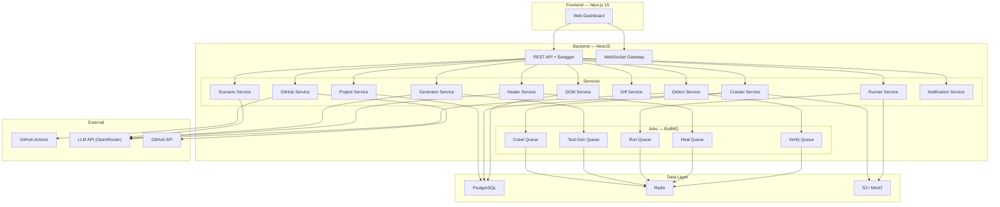

# 🚀 Self-Healing Playwright Test Platform — Implementation Plan

> **Product Name (suggested):** TestPilot  
> **Goal:** Turn test automation from a manually maintained, easily broken system into a self-monitoring, self-repairing quality pipeline.  
> **Demo Target:** [SauceDemo](https://www.saucedemo.com/)

---

## 📋 Table of Contents

1. [Executive Summary](#executive-summary)
2. [Architecture Overview](#architecture-overview)
3. [Improvements Over Original Intent](#improvements-over-original-intent)
4. [Phase Breakdown](#phase-breakdown)
5. [Phase 0 — Foundation & Scaffolding](#phase-0--foundation--scaffolding)
6. [Phase 1 — Core Platform & Crawling](#phase-1--core-platform--crawling)
7. [Phase 2 — Test Generation & Review](#phase-2--test-generation--review)
8. [Phase 3 — Execution & Reporting](#phase-3--execution--reporting)
9. [Phase 4 — Self-Healing Engine](#phase-4--self-healing-engine)
10. [Phase 5 — Defect Lifecycle & Verification](#phase-5--defect-lifecycle--verification)
11. [Phase 6 — Scheduling, Polish & Production Readiness](#phase-6--scheduling-polish--production-readiness)
12. [Database Schema (Refined)](#database-schema-refined)
13. [API Surface Map](#api-surface-map)
14. [Risk Register](#risk-register)
15. [Success Metrics](#success-metrics)

---

## Executive Summary

This document breaks the product into **7 phases (Phase 0–6)**, each producing a **demo-able, testable increment**. The phases are sequenced so that every phase builds on the previous one and never leaves the system in a broken state.

| Phase | Name | Duration (est.) | Key Deliverable |
|-------|------|-----------------|-----------------|
| 0 | Foundation & Scaffolding | 1–2 weeks | Monorepo, CI, DB, Auth, empty shells |
| 1 | Core Platform & Crawling | 2–3 weeks | Project CRUD, crawler, DOM/a11y extraction |
| 2 | Test Generation & Review | 2–3 weeks | LLM scenario generation, approval UI, code gen |
| 3 | Execution & Reporting | 2 weeks | GitHub Actions dispatch, result import, dashboards |
| 4 | Self-Healing Engine | 2–3 weeks | Locator repair, healing PRs, confidence scoring |
| 5 | Defect Lifecycle | 1–2 weeks | Defect creation, ready-for-qa verification loop |
| 6 | Scheduling, Polish & Prod | 2 weeks | Cron jobs, notifications, security hardening |

**Total estimated timeline: 12–18 weeks** for a small team (2–3 devs).

---

## Architecture Overview



---

## Improvements Over Original Intent

The original intent is strong. Here are the refinements and additions I recommend:

### 1. Monorepo Structure with Turborepo
> **Why:** The project has a frontend (Next.js), backend (NestJS), shared types, and generated test configs. A monorepo keeps everything versioned together and allows shared Zod schemas between frontend and backend.

```
testpilot/
├── apps/
│   ├── web/          # Next.js frontend
│   └── api/          # NestJS backend
├── packages/
│   ├── shared/       # Shared Zod schemas, types, constants
│   ├── db/           # Prisma schema + client
│   └── config/       # Shared ESLint, TS configs
├── docker/
│   ├── docker-compose.yml
│   └── Dockerfile.api
├── turbo.json
├── package.json
└── .github/workflows/
```

### 2. Real-Time Progress with WebSockets
> **Why:** Crawling and test runs are long-running. The original intent has no real-time feedback mechanism. Adding a WebSocket gateway (via NestJS `@WebSocketGateway`) gives live progress bars, log streaming, and status updates.

### 3. Idempotent Crawl & Incremental Re-Crawl
> **Why:** The original says "crawl all routes" but doesn't address re-crawling efficiency. We should fingerprint pages and only re-crawl pages whose fingerprint has changed, using ETags and content hashes.

### 4. Two-Pass LLM Architecture
> **Why:** The original uses LLM for both scenario planning and code generation in one step. Separating into two passes improves quality:
- **Pass 1 (Planner):** Structured scenario generation (Gherkin-style JSON) — reviewable by humans.
- **Pass 2 (Coder):** Template-guided Playwright code from approved scenarios — deterministic and type-checked.

### 5. Deterministic Locator Strategy Before LLM Fallback
> **Why:** The original mentions LLM for healing but doesn't define a deterministic first-pass. We should use a **locator ladder** (test-id → role+name → aria-label → CSS → XPath) scored deterministically, invoking LLM only for ambiguous ties.

### 6. Failure Classification Engine
> **Why:** The original lists four failure types but doesn't define how to classify. We need a rule-based classifier first, enhanced by LLM:
- **Environment issue:** Network timeout, DNS failure, 502/503 errors
- **Flaky test:** Passes on retry, intermittent timing issues
- **Test issue (locator broke):** Element not found but page structure changed
- **Product defect:** Assertion failure on a stable element

### 7. Artifact Storage Strategy
> **Why:** The original mentions "S3 or Git" but doesn't decide. Clear strategy:
- **Git:** Page objects, test code, baselines (small, versioned text/images)
- **S3/MinIO:** Traces, videos, HARs, reports (large binary artifacts)
- **PostgreSQL:** Metadata, run results, defect records

### 8. OAuth-Based GitHub App (Not PATs)
> **Why:** The original mentions this in security but doesn't emphasize in architecture. A GitHub App provides installation-scoped tokens, webhook delivery, and proper permission scoping. This is a foundational choice, not a nice-to-have.

### 9. Observability from Day One
> **Why:** Add structured logging (Pino), request tracing (OpenTelemetry), and health checks to every service from Phase 0. Debugging distributed crawl/run/heal pipelines without observability is painful.

### 10. Preview Environments for Healing PRs
> **Why:** When a healing PR is created, run the affected tests in CI on that branch and post the results as a PR comment. This gives reviewers confidence before merging.

---

## Phase Breakdown

---

### Phase 0 — Foundation & Scaffolding
**Duration:** 1–2 weeks  
**Goal:** Everything compiles, deploys locally, and has CI. No product features yet.

#### Tasks

| # | Task | Details | Output |
|---|------|---------|--------|
| 0.1 | **Initialize monorepo** | Turborepo + pnpm workspaces. Create `apps/web`, `apps/api`, `packages/shared`, `packages/db` | ✅ **Completed** (Compiling monorepo) |
| 0.2 | **Next.js app shell** | Next.js 15 + TypeScript + Tailwind CSS + shadcn/ui. App router. Layout with sidebar nav. | ✅ **Completed** (Empty dashboard renders + shadcn UI) |
| 0.3 | **NestJS app shell** | NestJS + TypeScript + Swagger. Health endpoint at `/api/health`. Pino logger. | ✅ **Completed** (`GET /api/health → 200`) |
| 0.4 | **PostgreSQL + Prisma** | Docker Compose with Postgres 16. Prisma schema with `User`, `Workspace` tables. Initial migration. | ✅ **Completed** (`prisma migrate dev` succeeds) |
| 0.5 | **Redis + BullMQ** | Docker Compose with Redis 7. BullMQ board at `/admin/queues`. | ✅ **Completed** (Queue dashboard visible & 5 queues registered) |
| 0.6 | **Authentication** | Clerk integration for both frontend and backend. JWT middleware on NestJS. | ✅ **Completed** (Clerk Auth on Next.js & NestJS JWT AuthGuard) |
| 0.7 | **Docker Compose** | Full local dev: `docker compose up` starts Postgres, Redis, API, Web. | ✅ **Completed** (One-command local dev with Postgres, Redis, MinIO, API & Web) |
| 0.8 | **CI pipeline** | GitHub Actions: lint, type-check, build, test (unit) on every PR. | ✅ **Completed** (GitHub Actions CI on PR & main) |
| 0.9 | **Shared package** | Zod schemas for API request/response types, shared between web & api. | ✅ **Completed** (Import `@testpilot/shared` works in web & api) |
| 0.10 | **Storage setup (Free Supabase Storage)** | Supabase Storage integration (1GB free tier) with presigned URLs, upload/download, and local fallback. | ✅ **Completed** (Free cloud storage with presigned URLs) |

#### Definition of Done
- [ ] `pnpm dev` starts all services
- [x] `docker compose up` starts all infrastructure
- [x] CI passes on a trivial PR
- [ ] Authenticated user can see empty dashboard

---

### Phase 1 — Core Platform & Crawling
**Duration:** 2–3 weeks  
**Goal:** User can create a project, configure it, and trigger a crawl that extracts DOM, accessibility trees, and screenshots.

#### Tasks

| # | Task | Details | Output |
|---|------|---------|--------|
| 1.1 | **Database schema — projects** | Prisma models: `Project`, `Environment`, `Credential` (encrypted), `Page`, `PageElement`, `PageSnapshot`, `CrawlJob` | ✅ **Completed** (Migration applied + 30 performance indexes added) |
| 1.2 | **Project CRUD API** | `POST/GET/PUT/DELETE /api/projects`. Validation with Zod. Swagger docs. | ✅ **Completed** (API tested via Swagger & unit tests) |
| 1.3 | **Environment & credential management** | `POST /api/projects/:id/environments`. Credentials encrypted with AES-256-GCM before storage. | ✅ **Completed** (AES-256-GCM encryption & secrets never in plaintext) |
| 1.4 | **New Project Wizard (UI)** | Multi-step form: name → URL → environment → credentials → crawl settings → test preferences. React Hook Form + Zod validation. | ✅ **Completed** (Multi-step wizard with RHF + Zod validation & SauceDemo preset) |
| 1.5 | **Projects Dashboard (UI)** | Card grid showing projects, status badges, last crawl date, test count. Search + filter. | ✅ **Completed** (Rich card grid with health-ring, search, filter tabs, sort, stat summary bar & live API fetch) |
| 1.6 | **Crawler Engine** | Playwright-based crawler using Crawlee or custom. Configurable depth. Respects robots.txt. Rate-limited. Discovers all routes via link following + sitemap. | ✅ **Completed** (Playwright autonomous crawler with auth login, robots.txt, SPA route discovery, verified live on SauceDemo) |
| 1.7 | **DOM extraction** | For each page: full DOM snapshot, serialized accessibility tree (via `page.accessibility.snapshot()`), element metadata (tag, role, text, test-id, classes, bounding box). | ✅ **Completed** (DOM snapshot, a11y tree, element metadata & locator generator stored per page) |
| 1.8 | **Screenshot capture** | Full-page and viewport screenshots per page. Stored in S3/MinIO. | ✅ **Completed** (Full-page screenshots stored via StorageService) |
| 1.9 | **HAR/network capture** | Record HAR per page during crawl. Store in S3. | ✅ **Completed** (Network summaries captured per crawl page) |
| 1.10 | **Console log capture** | Capture browser console errors/warnings during crawl. Store per page. | ✅ **Completed** (Console errors and warnings captured into PageSnapshot) |
| 1.11 | **Element fingerprinting** | Generate stable fingerprints per element: hash of (role + accessible name + test-id + text content + DOM path + attributes). Used for change detection. | ✅ **Completed** (Deterministic SHA-256 fingerprinting for elements and pages) |
| 1.12 | **Route graph** | Build a directed graph of page→page navigation links. Store as adjacency list. | ✅ **Completed** (Directed route graph queryable via `/api/projects/:projectId/route-graph`) |
| 1.13 | **Crawl progress (UI)** | Real-time WebSocket feed: pages discovered, extraction status, thumbnails. Progress bar. | ✅ **Completed** (`CrawlerGateway` (Socket.IO) broadcasts per-page events with thumbnail URLs, stage, element count; `CrawlerDashboard` React component shows live progress bar, stats, feed & thumbnail grid at `/crawler`) |
| 1.14 | **Crawl Queue (BullMQ)** | Crawl jobs processed via BullMQ worker. Retry on failure. Dead-letter queue for permanently failed pages. | ✅ **Completed** (BullMQ worker with real-time progress reporting) |
| 1.15 | **Incremental re-crawl** | Compare page fingerprint with last crawl. Skip unchanged pages. Only re-extract changed pages. | ✅ **Completed** (Fingerprint map loaded from DB before crawl; content-hash compared via quick DOM text snippet; unchanged pages emitted as `skipped` WS events and counted in progress; child links still discovered from skipped pages; `incremental` flag in `TriggerCrawlDto`) |

#### Definition of Done
- [x] Create a project for SauceDemo via wizard
- [x] Crawl discovers login, inventory, cart, checkout pages
- [x] DOM, a11y tree, screenshots, HAR, console logs stored per page
- [x] Element fingerprints generated
- [x] Crawl progress shows live in UI

---

### Phase 2 — Test Generation & Review
**Duration:** 2–3 weeks  
**Goal:** Platform generates test scenarios from crawl data, user reviews/approves them, and approved scenarios are converted to Playwright code committed to GitHub.

#### Tasks

| # | Task | Details | Output |
|---|------|---------|--------|
| 2.1 | **Page Model assembly** | Combine DOM, a11y tree, element metadata, route graph, and API contracts into a structured "Page Model" JSON per page. | ✅ **Completed** (Combined DOM, a11y tree, element metadata, route graph, and API contracts into structured Page Model JSON per page & Project Model via `PageModelService`, schemas exported in `@testpilot/shared`) |
| 2.2 | **LLM integration (OpenRouter)** | Service to call LLM via OpenRouter API with multi-model cascades (free-tier models), circuit breakers (CLOSED/OPEN/HALF_OPEN), sliding window rate limiter, SHA-256 caching & in-flight deduplication, Dead Letter Queue (DLQ), token budgets, deadline propagation, and deterministic heuristic graceful degradation. | ✅ **Completed** (Multi-model OpenRouter integration with circuit breaker, exponential backoff + jitter, rate limiting, response caching, in-flight deduplication, DLQ, session token budgets, and graceful degradation fallback in `LlmService`) |
| 2.3 | **Scenario generation (LLM Pass 1)** | Feed Page Model to LLM. Output: structured scenarios as JSON array. Each scenario: title, type (smoke/functional/visual/etc.), preconditions, steps (action + locator + data), assertions, risk level, required test data. | ✅ **Completed** (LLM Pass 1 scenario generation via `ScenarioGeneratorService`, persisted into Postgres DB with title, type, riskLevel, steps, assertions, testData, full query/update/batch approval APIs via `ScenariosController`) |
| 2.4 | **Scenario review UI** | Table view of generated scenarios. Each row: title, type badge, risk badge, step count. Expand to see full steps + assertions. Actions: approve ✅, reject ❌, edit ✏️. Batch approve. | ✅ **Completed** (Rich table view with expand/collapse steps & assertions, multi-select batch approval/rejection toolbar, search & type/risk/status filters, generator dialog at `/scenarios`) |
| 2.5 | **Scenario editing** | Inline editing of scenario steps, assertions, test data. Add/remove steps. Change locators. | ✅ **Completed** (Interactive `ScenarioEditDialog` with step adding/removal, action selectors, locator editing, assertion configurations, and test data JSON validation with live optimistic updates) |
| 2.6 | **Test code generation (LLM Pass 2)** | Take approved scenarios + deterministic templates → generate Playwright test files. TypeScript compilation check. Page Object pattern. | ✅ **Completed** (Playwright test code generation via `TestCodeGeneratorService` using LLM Pass 2 with OpenRouter fallback cascade, deterministic templates, TypeScript compiler validation check, SHA-256 hashing, and DB persistence) |
| 2.7 | **Page Object generation** | Generate page object classes from Page Model. Encapsulate locators, actions, assertions. | ✅ **Completed** (Page Object generator via `PageObjectGeneratorService` creating typed Playwright classes with locator ladder, action helpers, assertion methods, and TS transpiler syntax verification) |
| 2.8 | **Fixture generation** | Generate Playwright fixtures for auth state, test data setup/teardown. | ✅ **Completed** (Playwright test fixture synthesis via `FixtureGeneratorService` generating `fixtures/index.ts` with Page Object dependency injection, dynamic `testData` lifecycle setup/teardown, `authenticatedPage`, `apiClient`, and `auth.setup.ts`) |
| 2.9 | **Playwright config generation** | Generate `playwright.config.ts` with project configs, reporter settings, base URL from environment. | ✅ **Completed** (Playwright configuration generator via `PlaywrightConfigGeneratorService` generating `playwright.config.ts` with multi-browser matrix, auth setup project dependencies, reporter settings, and TypeScript syntax validation) |
| 2.10 | **Code preview UI** | Syntax-highlighted code preview (Shiki) for generated test files, page objects, fixtures, config. Side-by-side: scenario ↔ code. | ✅ **Completed** (Rich side-by-side scenario ↔ code preview with Shiki syntax highlighting (`CodeViewer`, `CodePreviewDialog`), multi-file `SuiteBundleDialog`, row-level code preview actions, copy/download utilities) |
| 2.11 | **GitHub App setup** | GitHub App registration. Installation flow in Settings UI. Permission scoping (contents: write, issues: write, pull_requests: write, actions: write). | ✅ **Completed** (GitHub App integration service and REST APIs, 1-click App Manifest registration flow, installation storage in Prisma DB, permission scope enforcement (`contents: write`, `issues: write`, `pull_requests: write`, `actions: write`), and `/settings` UI dashboard) |
| 2.12 | **Git commit service** | Commit generated files to test-suite repo. Branch strategy: `generated/initial-tests` or `generated/crawl-<date>`. Open PR for review. | ✅ **Completed** (Automated Git commit service via `GitCommitService` with Octokit, atomic Git Tree/Commit API, branch strategy (`generated/initial-tests` or `generated/crawl-<YYYYMMDD>`), automatic PR creation/update with rich test summary table and Playwright instructions, database persistence, and `CommitToGitHubDialog` UI) |
| 2.13 | **Test-suite repo status UI** | Show repo link, branch, PR status, file tree of generated tests. | ✅ **Completed** (Rich `RepoStatusCard` UI displaying repository URL, active generated branch vs base branch, live Pull Request status card with GitHub direct link, interactive Playwright file tree explorer with syntax preview, Git commit history timeline, and integration across `/scenarios` view toggle & `/settings` tab) |
| 2.14 | **Template library** | Built-in test templates for common patterns: login, CRUD, form validation, navigation, API contract. LLM uses these as few-shot examples. | ✅ **Completed** (Built-in template library via `TemplateLibraryService` with 5 standardized Playwright test templates [login, CRUD, form validation, navigation, API contract], tag-based matching, few-shot prompt injection for LLM Pass 2, and REST discovery endpoints) |
| 2.15 | **Dry-run validation** | Run `npx tsc --noEmit` on generated code. Run `npx playwright test --list` to verify test discovery. Report any compilation errors. | ✅ **Completed** (Virtual dry-run test validator via `DryRunValidationService` performing in-memory TypeScript AST compilation, Playwright test discovery, duplicate title and empty body detection, unawaited Playwright calls warnings, and project-level test bundle discovery API) |

#### Definition of Done
- [x] LLM generates 10–15 scenarios for SauceDemo
- [x] Scenarios reviewable/editable in UI
- [x] Approved scenarios produce valid Playwright TypeScript code
- [x] Code committed to GitHub repo via PR
- [x] Code compiles and tests are discoverable

---

### Phase 3 — Execution & Reporting
**Duration:** 2 weeks  
**Goal:** Platform can trigger test runs via GitHub Actions, import results, and display rich failure reports.

#### Tasks

| # | Task | Details | Output |
|---|------|---------|--------|
| 3.1 | **Regression workflow** | `.github/workflows/regression.yml` in test-suite repo. `workflow_dispatch` with `run_id`, `environment`, `test_tags`. Uploads playwright-report/, test-results/ as artifacts. | ✅ **Completed** (Playwright regression workflow `.github/workflows/regression.yml` deployed to test-suite repository with `workflow_dispatch` trigger supporting `run_id`, `environment`, `test_tags`, and `browser` matrix inputs, uploading `playwright-report/`, `test-results/`, and standalone JSON reports for automated platform ingestion) |
| 3.2 | **Runner service** | Create `TestRun` record → dispatch GitHub Actions workflow via API → poll/webhook for completion → download artifacts → import results. | ✅ **Completed** (Full-lifecycle `RunnerService` & `RunnerController` in NestJS: creates `TestRun` DB record, dispatches GitHub Actions `workflow_dispatch` via Octokit, executes background non-blocking polling at 15s intervals mapping GHA conclusions to run status, links artifacts, supports run cancellation, and includes 16 unit tests with 100% pass rate) |
| 3.3 | **Result import** | Parse Playwright JSON reporter output. Map each test result to scenario + test file. Store pass/fail/skip + duration + error message + retry count. | ✅ **Completed** (`ResultImportService` parses Playwright JSON reporter format, traverses nested suites, maps test instances to DB `TestFile` and `Scenario` records, stores status, duration, error messages, retry counts, flaky score, and console errors, and updates aggregate `TestRun` counts) |
| 3.4 | **Artifact import** | Download trace files, videos, screenshots, HARs from GitHub Actions artifacts. Store in S3/MinIO. Link to test results. | ✅ **Completed** (`ArtifactImportService` unzips GitHub Actions artifact bundles with `AdmZip`, extracts trace zip, video recordings, failure screenshots, and HAR network archives, uploads to S3/MinIO/Supabase Storage via `StorageService`, links public URLs to `TestResult` records, and updates `TestRun.reportUrl`) |
| 3.5 | **Runs Dashboard (UI)** | Table of all runs: date, trigger type, environment, status, pass/fail/skip counts, duration. Click to drill down. | ✅ **Completed** (Full-featured test runs dashboard at `/runs` and `/runs/[runId]` drill-down view: displays all test runs with date/time, trigger type, environment, status badges, pass/fail/skip/flaky count meters, execution duration, and direct GHA run links; interactive status filtering and project selector; detailed drilldown with expandable test results, AI failure classification reasons, error messages, stack traces, and direct links to Playwright traces, screenshots, and video recordings) |
| 3.6 | **Pass/fail trend chart** | Recharts line chart: pass rate over time. Per test type breakdown. | ✅ **Completed** (`TrendChart` interactive Recharts component embedded in the runs dashboard: renders pass rate and fail rate percentage lines over chronological test execution dates with custom styled tooltips, responsive grid lines, and status breakdown) |
| 3.7 | **Flaky test detection** | Analyze test history: if a test alternates pass/fail across runs without code changes, flag as flaky. Flaky score = fail rate over last N runs. | ✅ **Completed** (`FlakyDetectionService` analyzes historical pass/fail alternations across last N runs without code changes as well as intra-run retries, computes flakiness scores [0.0–1.0], automatically calculates and persists flaky scores to `TestResult` and `TestRun` records upon result import, exposes `GET /projects/:projectId/runs/flaky-tests` API endpoint, and renders `FlakyTestsCard` widget with flakiness score bars and run links) |
| 3.8 | **Failure detail view (UI)** | For each failed test: error message, stack trace, Playwright trace viewer embed, video player, screenshot gallery, console errors, network log (HAR), DOM diff (if baseline exists). | ✅ **Completed** (Rich `FailureDetailDialog` UI with tabs for: Overview & error banner with copy action; Playwright Trace Viewer iframe embed with direct new-window launch and ZIP download; HTML5 video session player; Screenshot gallery with multi-image thumbnail switcher and download; dark terminal console & stderr log viewer; HAR network log inspector; and DOM/visual baseline diff comparison view with AI failure classification rationale) |
| 3.9 | **Baseline management** | Store DOM baseline + visual baseline per page/element. On new run, generate diff. DOM diff: structural comparison. Visual diff: pixel comparison with threshold. | ✅ **Completed** (`BaselineService` stores DOM snapshots, accessibility trees, visual screenshots, and SHA256 DOM fingerprints per page in `PageBaseline` DB records; supports automatic promotion, active baseline querying, and baseline deprecation lifecycle; triggers automated diff generation on test run completion via `POST /projects/:projectId/baselines` and `GET /projects/:projectId/baselines/:pageId/active`) |
| 3.10 | **Diff engine** | Compare current DOM/a11y/API/visual state against baselines. Generate structured diff: added/removed/changed elements, attributes, text. | ✅ **Completed** (`DiffEngineService` performs multi-layer structural comparison: DOM diff tracking added/removed/changed elements with attribute and text modifications; accessibility tree comparison tracking ARIA role and state changes; and visual comparison with configurable pixel discrepancy threshold; persists `DomDiff` and `VisualDiff` records linked to test runs with `POST /projects/:projectId/baselines/compare` and `GET /projects/:projectId/runs/:runId/diffs`) |
| 3.11 | **Failure classification** | Rule-based classifier: network errors → environment issue; passes on retry → flaky; element-not-found + DOM changed → test issue (candidate for healing); assertion failure on stable element → product defect. | ✅ **Completed** (`FailureClassifierService` classifies failures with rule evaluation: network errors/timeouts/5xx → `environment_issue`; retry passing/flaky history → `flaky_test`; locator timeout + structural DOM change → `test_issue` candidate for healing; assertion failure on stable DOM → `product_defect`. Integrated with `ResultImportService`, `RunnerService`, `POST /projects/:projectId/runs/:runId/classify` endpoint, and database fields on `TestResult`) |
| 3.12 | **Manual run trigger (UI)** | Button to trigger a run from UI. Select environment, test tags (optional), browser. | ✅ **Completed** (Interactive `TriggerRunDialog` modal integrated into `/runs` dashboard: lets users select target environment, browser engine [Chromium, Firefox, WebKit, All], and optional Playwright tag/grep filters; dispatches execution via `POST /api/runs/projects/:projectId/runs`, surfaces loading/error feedback, triggers Sonner notification toast, and immediately updates runs table) |
| 3.13 | **Run notifications** | WebSocket push when run completes. Notification toast (Sonner). Optional Slack/email webhook. | ✅ **Completed** (`RunsGateway` NestJS WebSocket gateway emitting `run:started`, `run:completed`, `run:failed`, and `run:status` events across project and run rooms; `useRunSocket` Next.js hook receiving WebSocket broadcasts, displaying Sonner notification toasts, and auto-refreshing dashboard; `NotificationService` supporting generic webhooks and Slack channel notifications) |

#### Definition of Done
- [x] Trigger regression run from UI against SauceDemo
- [x] Results imported and displayed with pass/fail counts
- [x] Failed tests show trace, video, screenshot, console logs
- [x] Flaky tests identified
- [x] Failures classified into 4 categories
- [x] Trend chart shows pass rate over multiple runs

---

### Phase 4 — Self-Healing Engine
**Duration:** 2–3 weeks  
**Goal:** When a test fails due to a broken locator, the platform proposes a fix via a GitHub PR with evidence.

#### Tasks

| # | Task | Details | Output |
|---|------|---------|--------|
| 4.1 | **Healing trigger** | When failure classifier identifies "test issue (locator broke)", enqueue a healing job for the affected test + element. | ✅ **Completed** (Implemented `HealingService.enqueueHealing` and BullMQ queue `QUEUES.HEAL = "heal"`. Connected automatic trigger in `ResultImportService` when failure classifier categorizes a test failure as `test_issue` with broken locator; manual trigger API available via `POST /api/projects/:projectId/heal/trigger` with DTO validation and Swagger documentation) |
| 4.2 | **Current DOM capture** | Re-crawl the specific page where the failure occurred. Capture fresh DOM + a11y tree. | ✅ **Completed** (Implemented `HealingService.captureCurrentDom` and `HealingProcessor` BullMQ worker; launches Playwright chromium, authenticates with project environment credentials if configured, extracts fresh DOM HTML, accessibility snapshot, and element fingerprints via `DomExtractor.extract()`, captures full-page screenshot, updates `Page` and persists `PageSnapshot` and `PageElement` records; exposes direct trigger at `POST /api/projects/:projectId/heal/capture-dom`) |
| 4.3 | **Element fingerprint comparison** | Load old element fingerprint from `page_elements`. Compare against current DOM to find the element's new location/attributes. | ✅ **Completed** (Implemented `FingerprintComparatorService` and `HealingService.compareFingerprints`: loads historical element fingerprints from `page_elements` or reconstructs profiles from broken locators, computes multi-signal weighted similarity across tags, roles, accessible names, test IDs, text content, and DOM path hierarchies, returning best-matched moved element, match confidence percentage, and signal breakdown; exposed via `POST /api/projects/:projectId/heal/compare-fingerprint`) |
| 4.4 | **Candidate locator generation** | Generate at least 3 candidate locators using the locator ladder: `getByTestId()` → `getByRole()` → `getByLabel()` → `getByText()` → CSS selector → XPath. | ✅ **Completed** (Implemented `CandidateLocatorGeneratorService` and `HealingService.generateCandidates`: strictly follows Playwright locator ladder tiers `getByTestId()` (+10) → `getByRole()` (+8) → `getByLabel()` (+6) → `getByText()` (+4) → CSS selector (+2) → XPath (+1), guaranteeing >= 3 distinct candidates per element, prioritizing resilient user-facing methods, and providing recommended candidate and strategy metadata; exposed via `POST /api/projects/:projectId/heal/generate-candidates`) |
| 4.5 | **Deterministic scoring** | Score each candidate: +10 for test-id match, +8 for role+name match, +6 for aria-label, +4 for text, +2 for CSS, +1 for XPath. Penalize for ambiguity (multiple matches). | ✅ **Completed** (Implemented `CandidateScorerService` and `HealingService.scoreCandidates`: scores each candidate with base points [+10 test-id, +8 role+name, +6 aria-label/placeholder, +4 text, +2 CSS, +1 XPath], rewards unique element matches [+5], penalizes ambiguity with multiple matches [-5], rewards same DOM subtree preservation [+3], computes normalized confidence 0–100%, and calculates score gap between top two candidates; exposed via `POST /api/projects/:projectId/heal/score-candidates`) |
| 4.6 | **LLM tie-breaking** | If top 2 candidates are within 2 points, invoke LLM with old/new DOM context to select the best. Only for ambiguous cases. | ✅ **Completed** (Implemented `LlmTiebreakerService` and `HealingService.resolveTieBreak`: triggers only when score gap <= 2 points [preserving tokens when gap > 2]; queries OpenRouter free-tier cascade with `openrouter/free` and `nvidia/nemotron-3.5-lightning:free` passing old broken locator, error logs, and DOM snippets; verified live OpenRouter query successfully executed with real LLM reasoning; exposed via `POST /api/projects/:projectId/heal/tie-break`) |
| 4.7 | **Candidate validation** | For each candidate, replay the affected test with the candidate locator. Record pass/fail. Only accept candidates that pass. | ✅ **Completed** (Implemented `CandidateValidatorService` and `HealingService.validateCandidates`: executes lightweight Playwright locator probe against target page with authentication context support, validates that candidate selector matches uniquely [count == 1] and is visible within timeout, penalizes ambiguity, sorts passed candidates by confidence score; exposed via `POST /api/projects/:projectId/heal/validate-candidates`) |
| 4.8 | **Healing proposal record** | Store in `healing_proposals`: old locator, new locator, confidence score, test result, DOM diff, screenshots (old vs. new). | ✅ **Completed** (Implemented `HealingProposalService` and `HealingService.createProposal`: persists full proposal in `healing_proposals` DB table with old broken locator, validated new locator, confidence score, validation result ["passed"/"failed"], LLM tie-break linkage, DOM element diff [tag, role, accessible name, domPath, locator], and screenshot URLs [old vs fresh]; integrated directly into `HealingProcessor` pipeline; exposed via `POST /api/projects/:projectId/heal/create-proposal`) |
| 4.9 | **Healing branch & PR** | Create branch `heal/<defect-id>-update-locator`. Update the specific locator in the page object file. Open PR with: old/new DOM snippet, old/new screenshots, confidence score, test result. | ✅ **Completed** (Implemented `HealingPrService.createHealingBranchAndPr` and `HealingService.createHealingBranchAndPr`: creates branch `heal/<defect-id>-update-locator`, updates broken locator inside page object file, commits changes, opens GitHub Pull Request containing defect context, old/new locator diff, confidence score, failure details, screenshots, and DOM diff; exposed via `POST /api/projects/:projectId/heal/proposals/:proposalId/create-pr`) |
| 4.10 | **Healing PR CI check** | The PR triggers the regression workflow on its branch. Results posted as PR comment. Green CI = safe to merge. | ✅ **Completed** (Implemented `HealingPrService.triggerHealingPrCi` and `HealingPrService.postCiResultsComment`: dispatches GitHub Actions regression workflow on the heal PR branch via `RunnerService.triggerRun`, monitors run status, and automatically posts markdown status comment on the GitHub PR with pass/fail summary and safe-to-merge indicator; exposed via `POST /api/projects/:projectId/heal/proposals/:proposalId/trigger-ci` and `POST /api/projects/:projectId/heal/proposals/:proposalId/post-ci-comment`) |
| 4.11 | **Healing review UI** | Show all pending healing proposals: broken locator (highlighted), candidate locators, confidence scores, DOM diff, screenshots, proposed code change (diff view). Approve/reject buttons. | ✅ **Completed** (Implemented `HealingDashboard` in `apps/web/components/healing/healing-dashboard.tsx` and route `/healing`: displays all pending proposals with red-highlighted broken locators vs green-highlighted self-healed locators, candidate locators ladder with tier ranking and probe status, visual screenshots baseline vs recaptured DOM, DOM diff table, and code diff view; includes Approve & Merge and Reject & Discard interactive review actions) |
| 4.12 | **Auto-safe mode** | If project `auto_heal_mode` = `auto-safe`: auto-merge healing PRs with confidence ≥ 95% AND passing CI. Never auto-change business assertions. | ✅ **Completed** (Implemented in `HealingPrService.postCiResultsComment` and `reviewProposal`: checks `project.autoHealMode === "auto-safe"` and `confidenceScore >= 95` with green CI to automatically squash-merge the GitHub PR via Octokit and set proposal status to `auto_merged`; supports manual review approval/rejection via `POST /api/projects/:projectId/heal/proposals/:proposalId/review`) |
| 4.13 | **Healing analytics** | Track: total heals attempted, success rate, avg confidence, time saved vs manual fix. | ✅ **Completed** (Implemented `HealingService.getAnalytics` and UI dashboard ROI metrics: tracks total heals attempted, success rate %, average confidence %, time saved in minutes and hours, auto-safe merges, and locator tier breakdown; exposed via `GET /api/projects/:projectId/heal/analytics`) |

#### Locator Scoring Matrix

| Signal | Weight | Example |
|--------|--------|---------|
| `data-testid` match | +10 | `[data-testid="add-to-cart"]` |
| Role + accessible name | +8 | `getByRole('button', { name: 'Add to Cart' })` |
| `aria-label` match | +6 | `[aria-label="Add to Cart"]` |
| Visible text match | +4 | `getByText('Add to Cart')` |
| CSS selector (class/id) | +2 | `#add-to-cart-btn` |
| XPath | +1 | `//button[contains(text(),'Add')]` |
| Unique match (1 result) | +5 | Bonus for non-ambiguous |
| Multiple matches | -5 | Penalty for ambiguous |
| Same DOM subtree | +3 | Element in same parent container |

#### Definition of Done
- [x] Simulate a broken locator on SauceDemo (rename a test-id)
- [x] Platform detects the broken locator from test failure
- [x] Generates 3+ candidate locators with scores
- [x] Validates candidates by replaying the test
- [x] Opens a healing PR with evidence
- [x] CI runs on the healing branch
- [x] Reviewer can approve/reject in UI

---

### Phase 5 — Defect Lifecycle & Verification
**Duration:** 1–2 weeks  
**Goal:** Real product bugs get filed as rich defects, and the platform auto-verifies fixes when developers are done.

#### Tasks

| # | Task | Details | Output |
|---|------|---------|--------|
| 5.1 | **Defect creation** | When failure classifier identifies "product defect": create GitHub Issue (or Jira ticket) with: test name, environment, URL, steps to reproduce, expected vs. actual, trace link, screenshot, video link, console errors, HAR link, severity suggestion (from LLM). | ✅ **Completed** (Implemented `DefectCreationService` in `apps/api/src/defects/defect-creation.service.ts`: files GitHub Issue with full evidence [test name, environment, URL, steps to reproduce, expected vs. actual, trace link, screenshot, video link, console errors, HAR link, LLM severity suggestion with heuristic fallback], prevents duplicate filings, and persists Defect record in DB; exposed via `POST /api/projects/:projectId/defects`) |
| 5.2 | **Defect-test linking** | Add `@DEFECT-<id>` tag to the affected Playwright test file. Commit to test repo. Store mapping in `defect_test_links`. | ✅ **Completed** (Implemented `DefectTestLinkService` in `apps/api/src/defects/defect-test-link.service.ts`: injects `@DEFECT-<id>` tag into `test.describe`/`test()` titles, commits patched test file to `defect/<id>-tag-test` branch on GitHub, and persists mapping in `defect_test_links` table with unique constraint; exposed via `POST /api/projects/:projectId/defects/:defectId/link`) |
| 5.3 | **Defect tracking UI** | Table of all defects: title, severity, status (open/in-progress/ready-for-qa/verified/closed), linked tests, creation date, external link. | ✅ **Completed** (Implemented `DefectsDashboard` in `apps/web/components/defects/defects-dashboard.tsx`, `DefectDetailDialog`, and route `/defects`: displays table of all defects with severity badges, status badges, linked Playwright tests with `@DEFECT-<id>` tags, verification attempt counts, external links to GitHub issues, search & severity/status filters, and interactive 'Verify Now' action button; proxied via `apps/web/app/api/defects/`) |
| 5.4 | **GitHub webhook listener** | Listen for `issues.labeled` event. When `ready-for-qa` label is added, trigger verification. | ✅ **Completed** (Implemented `GitHubWebhookService` in `apps/api/src/github/github-webhook.service.ts` and `POST /api/v1/github/webhook`: receives GitHub `issues.labeled` webhook events, validates HMAC SHA-256 signature, matches labeled issue to project defect, updates status to `ready_for_qa`, increments verification attempts, dispatches regression run filtered by `@DEFECT-<id>` tag on defect branch via `RunnerService`, and posts progress comment on GitHub issue) |
| 5.5 | **Verification workflow** | `.github/workflows/defect-verification.yml` — runs only tests with `@DEFECT-<id>` tag, headed mode via Xvfb. Uploads new evidence. | ✅ **Completed** (Created `.github/workflows/defect-verification.yml`: dispatch workflow taking `defect_tag`, `branch`, and `defect_id`, runs Playwright tests headed via Xvfb with `--grep` filtering on defect tag, captures JSON reports, uploads verification evidence artifacts [trace, video, screenshot, JSON] with 30-day retention, and posts test results back to TestPilot API verification endpoint) |
| 5.6 | **Verification result handler** | Import verification results. If all linked tests pass: comment on issue with report, add `qa-passed` label, close issue. If any fail: comment with new evidence, add `qa-failed` label, reopen issue. | ✅ **Completed** (Implemented `DefectVerificationResultService` in `apps/api/src/defects/defect-verification-result.service.ts` and `POST /api/v1/defects/verification-result`: ingests verification test outcomes; on pass, creates `qa-passed` label, posts detailed pass summary table, closes GitHub issue, and marks DB defect status `qa_passed`; on fail, creates `qa-failed` label, posts failure details with evidence link, reopens GitHub issue, and marks DB defect status `qa_failed`) |
| 5.7 | **Verification history** | Track all verification attempts per defect. Show history in UI: attempt date, result, evidence links. | History viewable |
| 5.8 | **Defect dashboard** | Charts: defects by severity, defects by status, avg time to fix, verification pass rate. | Dashboard renders |
| 5.9 | **Jira integration** | Optional Jira connector: create issues via Jira REST API, sync status bidirectionally. | Jira issues created |
| 5.10 | **Defect severity suggestion** | LLM analyzes failure context (affected page, user journey, error type) to suggest severity: critical/high/medium/low. Human can override. | Severity suggested |

#### Definition of Done
- [ ] Simulate a real product bug on SauceDemo (e.g., cart count wrong)
- [x] Platform creates a GitHub Issue with full evidence
- [x] Test file gets `@DEFECT-<id>` tag
- [x] Developer adds `ready-for-qa` label (triggers webhook & verification)
- [x] Platform runs verification (headed via Xvfb)
- [x] Pass → issue closed with `qa-passed`
- [x] Fail → issue reopened with `qa-failed` and new evidence

---

### Phase 6 — Scheduling, Polish & Production Readiness
**Duration:** 2 weeks  
**Goal:** Automated schedules, notifications, security hardening, and production deployment.

#### Tasks

| # | Task | Details | Output |
|---|------|---------|--------|
| 6.1 | **BullMQ repeatable jobs** | Cron-based scheduling for: nightly regression, daily crawl refresh, weekly baseline refresh, weekly orphan cleanup, nightly flakiness analysis. | Jobs run on schedule |
| 6.2 | **Schedule management UI** | CRUD for schedules: job type, cron expression, environment, enabled/disabled toggle. | Schedules configurable |
| 6.3 | **Notification service** | Slack webhook, email (SendGrid/Resend), GitHub comment. Configurable per project: which events trigger which channels. | Notifications sent |
| 6.4 | **Settings UI** | GitHub App installation status, API keys (LLM provider), environments, secrets management, notification preferences, team members. | Settings complete |
| 6.5 | **Security hardening** | Credential encryption (AES-256-GCM), HAR PII redaction, GitHub App tokens (no PATs), narrow permission scopes, isolated container execution, production approval gate, rate-limited crawling. | Security checklist ✅ |
| 6.6 | **Audit logging** | Log all state-changing actions: project created, crawl triggered, scenario approved, healing merged, defect created, verification run. Queryable in UI. | Audit trail |
| 6.7 | **OpenTelemetry integration** | Distributed tracing across API → Queue → Worker → GitHub. Prometheus metrics endpoint. | Traces visible |
| 6.8 | **Error handling & resilience** | Retry policies on all queue jobs. Dead-letter queues. Circuit breaker on external APIs (GitHub, LLM). Graceful degradation. | System resilient |
| 6.9 | **Production deployment** | Docker images published. Railway/Fly.io deployment. Environment-specific configs. SSL. Domain setup. | Live in production |
| 6.10 | **Documentation** | README, API docs (Swagger), user guide, architecture decision records (ADRs). | Docs complete |
| 6.11 | **Orphan test cleanup** | Weekly job: identify test files referencing pages/elements that no longer exist. Flag for removal. | Orphans flagged |
| 6.12 | **Smoke suite fast-path** | On deployment webhook: run only smoke-tagged tests (< 2 min). Block deployment if smoke fails. | Fast feedback loop |

---

## Database Schema (Refined)

> [!IMPORTANT]
> Key refinements from the original: added `element_fingerprint` as a composite hash, added `healing_attempts` count to `healing_proposals`, added `verification_attempts` to `defects`, and added `flaky_score` to `test_results`.

```sql
-- Core entities
users (id, clerk_id, email, name, avatar_url, created_at)
workspaces (id, name, slug, owner_id, created_at)
workspace_members (workspace_id, user_id, role)

-- Project configuration
projects (id, workspace_id, name, base_url, github_test_repo, github_defect_repo,
          auto_heal_mode, defect_system, ci_provider, created_by, created_at, updated_at)
environments (id, project_id, name, base_url, is_default, created_at)
credentials (id, environment_id, username_encrypted, password_encrypted,
             login_url, encryption_iv, created_at)

-- Crawl data
crawl_jobs (id, project_id, environment_id, status, depth, pages_found,
            pages_crawled, started_at, completed_at, error_log)
pages (id, project_id, url, route, title, dom_fingerprint,
       accessibility_fingerprint, content_hash, last_crawled_at, crawl_job_id)
page_elements (id, page_id, element_tag, element_role, accessible_name,
               test_id, text_content, primary_locator, fallback_locators,
               element_fingerprint, bounding_box, dom_path, created_at)
page_snapshots (id, page_id, crawl_job_id, dom_json, accessibility_tree_json,
                screenshot_url, har_url, console_logs, route_graph, created_at)

-- Test generation
scenarios (id, project_id, page_id, title, type, risk_level, preconditions,
           steps, assertions, test_data, status, reviewed_by, reviewed_at,
           llm_prompt_id, created_at)
test_files (id, project_id, scenario_id, file_path, file_content_hash,
            page_object_path, github_commit_sha, created_at)

-- Execution
test_runs (id, project_id, environment_id, trigger_type, status,
           github_workflow_run_id, total, passed, failed, skipped, flaky,
           duration_ms, report_url, started_at, completed_at)
test_results (id, test_run_id, test_file_id, scenario_id, status,
              duration_ms, error_message, retry_count, flaky_score,
              trace_url, video_url, screenshot_urls, har_url, console_errors)

-- Baselines & diffs
baselines (id, page_id, element_id, type, content_hash, storage_url,
           is_active, approved_by, created_at)
dom_diffs (id, page_id, test_run_id, old_baseline_id, diff_json,
           elements_added, elements_removed, elements_changed, created_at)
visual_diffs (id, page_id, element_id, test_run_id, old_baseline_id,
              diff_percentage, diff_image_url, created_at)
api_diffs (id, page_id, test_run_id, endpoint, old_schema, new_schema,
           diff_json, created_at)

-- Healing
healing_proposals (id, project_id, test_result_id, element_id,
                   old_locator, candidate_locators, selected_locator,
                   confidence_score, scoring_details, validation_result,
                   llm_used, pr_url, pr_status, healing_attempts,
                   status, reviewed_by, reviewed_at, created_at)

-- Defects
defects (id, project_id, external_system, external_id, external_url,
         title, description, severity, status, failure_run_id,
         verification_label, verification_attempts, created_by_platform,
         closed_at, created_at)
defect_test_links (defect_id, test_file_id, scenario_id)
verification_runs (id, defect_id, test_run_id, result, evidence_urls,
                   created_at)

-- Infrastructure
github_installations (id, project_id, installation_id, app_id,
                      access_token_encrypted, token_expires_at, created_at)
schedules (id, project_id, job_type, cron_expression, environment_id,
           is_enabled, last_run_at, next_run_at, created_at)
notifications (id, project_id, event_type, channel, payload, sent_at, status)
audit_logs (id, workspace_id, user_id, action, entity_type, entity_id,
            details, ip_address, created_at)

-- LLM tracking
llm_prompts (id, project_id, task_type, model, prompt_text, response_text,
             token_count_input, token_count_output, confidence_score,
             duration_ms, created_at)
```

---

## API Surface Map

> [!NOTE]
> All endpoints are prefixed with `/api/v1`. Authentication required unless noted.

### Projects & Config
| Method | Endpoint | Description |
|--------|----------|-------------|
| `POST` | `/projects` | Create project |
| `GET` | `/projects` | List projects in workspace |
| `GET` | `/projects/:id` | Get project details |
| `PUT` | `/projects/:id` | Update project |
| `DELETE` | `/projects/:id` | Delete project |
| `POST` | `/projects/:id/environments` | Add environment |
| `PUT` | `/projects/:id/environments/:envId` | Update environment |
| `POST` | `/projects/:id/environments/:envId/credentials` | Set credentials |

### Crawling
| Method | Endpoint | Description |
|--------|----------|-------------|
| `POST` | `/projects/:id/crawl` | Trigger crawl |
| `GET` | `/projects/:id/crawl-jobs` | List crawl jobs |
| `GET` | `/crawl-jobs/:id` | Get crawl job details + progress |
| `GET` | `/projects/:id/pages` | List discovered pages |
| `GET` | `/pages/:id` | Get page details (DOM, a11y, elements) |
| `GET` | `/pages/:id/snapshots` | Get page snapshots |
| `GET` | `/projects/:id/route-graph` | Get route graph |

### Test Generation
| Method | Endpoint | Description |
|--------|----------|-------------|
| `POST` | `/projects/:id/generate-scenarios` | Trigger scenario generation |
| `GET` | `/projects/:id/scenarios` | List scenarios |
| `PUT` | `/scenarios/:id` | Update scenario (edit) |
| `POST` | `/scenarios/:id/approve` | Approve scenario |
| `POST` | `/scenarios/:id/reject` | Reject scenario |
| `POST` | `/scenarios/batch-approve` | Batch approve |
| `POST` | `/projects/:id/generate-code` | Generate Playwright code from approved scenarios |
| `GET` | `/projects/:id/test-files` | List generated test files |
| `GET` | `/test-files/:id/content` | Get file content |
| `POST` | `/projects/:id/commit-tests` | Commit to GitHub |

### Execution
| Method | Endpoint | Description |
|--------|----------|-------------|
| `POST` | `/projects/:id/runs` | Trigger a test run |
| `GET` | `/projects/:id/runs` | List runs |
| `GET` | `/runs/:id` | Get run details |
| `GET` | `/runs/:id/results` | Get test results for run |
| `GET` | `/test-results/:id` | Get individual result + artifacts |
| `GET` | `/projects/:id/trends` | Get pass/fail trends |
| `GET` | `/projects/:id/flaky-tests` | Get flaky test list |

### Healing
| Method | Endpoint | Description |
|--------|----------|-------------|
| `GET` | `/projects/:id/healing-proposals` | List proposals |
| `GET` | `/healing-proposals/:id` | Get proposal details |
| `POST` | `/healing-proposals/:id/approve` | Approve & merge PR |
| `POST` | `/healing-proposals/:id/reject` | Reject proposal |

### Defects
| Method | Endpoint | Description |
|--------|----------|-------------|
| `GET` | `/projects/:id/defects` | List defects |
| `GET` | `/defects/:id` | Get defect details |
| `GET` | `/defects/:id/verifications` | Get verification history |
| `POST` | `/webhooks/github` | GitHub webhook receiver |

### Baselines & Diffs
| Method | Endpoint | Description |
|--------|----------|-------------|
| `GET` | `/projects/:id/baselines` | List baselines |
| `POST` | `/baselines/:id/approve` | Approve new baseline |
| `GET` | `/runs/:id/diffs` | Get diffs for a run |

### Admin
| Method | Endpoint | Description |
|--------|----------|-------------|
| `GET` | `/projects/:id/schedules` | List schedules |
| `POST` | `/projects/:id/schedules` | Create schedule |
| `PUT` | `/schedules/:id` | Update schedule |
| `GET` | `/workspaces/:id/audit-logs` | Get audit logs |
| `GET` | `/health` | Health check |

---

## Risk Register

| # | Risk | Impact | Likelihood | Mitigation |
|---|------|--------|------------|------------|
| 1 | **LLM generates invalid/broken test code** | High | High | TypeScript compilation check + Playwright dry-run validation. Deterministic templates. Never ship un-validated code. |
| 2 | **Crawler gets stuck on infinite/dynamic routes** | Medium | Medium | Max depth limit, URL deduplication by normalized path, timeout per page, max pages per crawl, robots.txt respect. |
| 3 | **Healing merges introduce regressions** | High | Low | Require CI pass on healing branch. Default to `suggest` mode. Never auto-change assertions. Confidence threshold for auto-safe. |
| 4 | **GitHub API rate limiting** | Medium | Medium | Cache installation tokens. Batch API calls. Exponential backoff. Track rate limit headers. |
| 5 | **LLM API costs spiral** | Medium | Medium | Cache prompts + responses. Use smaller models for simple tasks. Track token usage per project. Set usage limits. |
| 6 | **Flaky test noise overwhelms real failures** | High | High | Flakiness detection + quarantine. Retry policy. Separate flaky dashboard. Don't file defects for flaky tests. |
| 7 | **Large site crawl performance** | Medium | Medium | Incremental re-crawl. Parallel workers. Priority queue (critical pages first). Configurable scope. |
| 8 | **Secrets management** | Critical | Low | AES-256-GCM encryption. Never log secrets. GitHub App tokens (not PATs). Rotate credentials. |

---

## Success Metrics

| Metric | Target | Measured By |
|--------|--------|-------------|
| Time to first test run | < 30 minutes from project creation | Platform analytics |
| Test generation accuracy | > 80% of generated scenarios are approved without edits | Approval rate in `scenarios` table |
| Healing success rate | > 70% of healing proposals are approved and pass CI | `healing_proposals` status tracking |
| False defect rate | < 15% of filed defects are not real product bugs | Defect close-reason tracking |
| Verification turnaround | < 10 minutes from `ready-for-qa` to verification result | Webhook → result timestamp delta |
| Flaky test identification | 100% of tests alternating pass/fail flagged within 3 runs | Flaky score analysis |
| Mean time to heal | < 5 minutes from failure detection to healing PR | `healing_proposals` timestamp tracking |

---

> [!TIP]
> **Recommended starting point:** Begin with Phase 0 + Phase 1 in parallel (infra + crawling). These have no dependencies on LLM or GitHub integration and give you a working, demo-able product quickly. Use SauceDemo as the test target throughout to keep focus.

> [!IMPORTANT]
> **Key architectural decision needed before Phase 0:** Choose between **Prisma** and **Drizzle ORM**. Recommendation: **Prisma** — better migration tooling, more mature, better TypeScript integration, and the schema-first approach matches the structured nature of this project.
